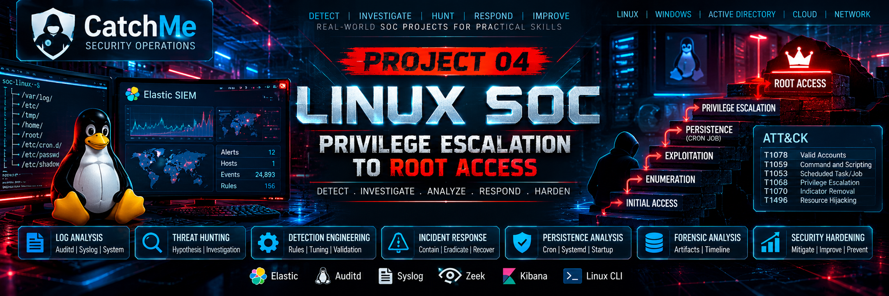

# Project 04 — Linux Privilege Escalation & Root Access

> **CatchMe Linux SOC Portfolio** · Evidence-led Linux privilege-escalation investigation

## 1. Project Overview

This project documents a controlled Linux privilege-escalation assessment against the `soc-linux` lab host and the corresponding Elastic SIEM investigation. It focuses on identifying risky privilege boundaries, validating relevant telemetry, recording evidence, and distinguishing confirmed behavior from baseline reconnaissance.

The project is designed as a SOC investigation exercise: each task should connect the tested condition, host evidence, Elastic telemetry, security interpretation, and cleanup status.

## 2. Objectives

- Establish a baseline for users, permissions, privileged executables, scheduled tasks, SSH files, NFS, and kernel status.
- Investigate common Linux privilege-escalation paths without silently changing the protected lab host.
- Validate endpoint process telemetry in Elastic SIEM where available.
- Record exact timestamps, commands, observed results, screenshots, and evidence locations.
- Separate confirmed controlled demonstrations from checks that only establish baseline state.
- Preserve evidence and remove temporary test artifacts when safe.
- Map findings to MITRE ATT&CK only when supported by observed behavior.

## 3. Lab Environment

| Component | Value |
|---|---|
| Target host | `soc-linux` |
| Target IP | `192.168.1.16` |
| Attacker system | Kali Linux, `192.168.1.10` |
| SIEM | Elastic, `192.168.1.11` |
| Target OS | Ubuntu 24.04.4 LTS |
| Architecture | ARM64 (`aarch64`) |
| Kernel observed | `6.8.0-146-generic` |
| Endpoint telemetry | Elastic Agent / Elastic Defend process events |
| Timezone used for evidence | Asia/Kolkata (IST, UTC+05:30) |

These values describe the lab observations recorded during this project. Recheck them if the environment changes.

## 4. Safety and Scope

The `soc-linux` VM is retained for future CatchMe portfolio projects. Do not introduce new weaknesses into its system configuration for demonstration purposes.

- Do not modify `/etc/passwd`, `/etc/shadow`, sudoers, system cron configuration, or system executable permissions for this project.
- Do not run kernel exploits or inject shared libraries on this VM.
- Perform exploit demonstrations requiring intentionally vulnerable configuration only in a disposable VM or a restorable snapshot.
- Use read-only enumeration on the protected host wherever possible.
- Preserve the Task 8 validation log and existing project evidence.
- Never describe reconnaissance, an attempted command, or a telemetry event as a successful exploit without proof of the resulting security impact.
- Do not include secrets, private keys, password hashes, or other sensitive values in screenshots or documentation.

## 5. Scenario and Investigation Approach

The assessment follows common Linux privilege-escalation categories: writable files and configuration, sudo policy, scheduled tasks, SUID/SGID executables, shell and environment behavior, credentials and SSH keys, NFS, kernel exposure, and privilege-assessment tooling.

For each task, record:

1. Objective and hypothesis.
2. Baseline command and host state.
3. Any controlled action actually performed.
4. Host-side proof of outcome, if applicable.
5. Elastic telemetry and its exact time range.
6. Interpretation, limitations, and cleanup.
7. Evidence references and integrity information.

## 6. Current Evidence-Based Status

| Task | Current status |
|---|---|
| Task 8 — Cron job file permissions | A controlled root-execution demonstration was observed through the temporary validation script. The temporary cron entry was removed. The validation log is retained; the temporary script was subsequently removed. |
| Task 9 — Cron `PATH` | Baseline checks only. No PATH-hijack attack was demonstrated. Temporary preparation artifacts were removed. |
| Task 10 — Cron wildcards | Baseline cron telemetry only. No wildcard-based escalation was demonstrated. |
| Task 11 — SUID/SGID known exploits | Inventory and package checks completed. No known-exploit escalation was demonstrated. |
| Task 12 — Shared object injection | Dependency and library-permission checks performed. No injection was attempted. |
| Task 13 — SUID environment variables | Baseline checks completed. No environment-variable exploit was demonstrated. |
| Tasks 14–15 — Shell features | Shell permissions, package versions, and capabilities checked. No shell-feature escalation was demonstrated. |
| Task 16 — History files | File metadata checked. No credentials were recovered. |
| Task 17 — Configuration files | Standard configuration permissions checked. No writable configuration vulnerability was demonstrated. |
| Task 18 — SSH keys | SSH directory and key-file metadata checked. No private key was found by the scoped filename search. |
| Task 19 — NFS | No local NFS mounts or active NFS services were observed; NFS utilities and exports configuration were not found by the checks performed. |
| Task 20 — Kernel exploits | Kernel version, architecture, and exposed mitigation-status interface recorded. No kernel exploit was run. |
| Task 21 — Privilege-escalation scripts | Common tool discovery checks completed. No assessment tool was found in the searched locations. |

**Status discipline:** “Baseline complete” means the stated checks were run. It does not mean that an attack was successful, that the host is vulnerability-free, or that telemetry generated a detection alert. Validate the target's final filesystem state before marking cleanup as verified.

## 7. Repository Structure

- `00-pre-attack/` — objectives, baseline, scope, controls, and telemetry requirements.
- `01-attack/` — attack plans, scenarios, execution records, and timelines.
- `02-telemetry/` — expected and observed telemetry, sources, and correlation.
- `03-threat-hunting/` — hypotheses, queries, triage, timelines, and findings.
- `04-detection/` — detection logic, validation, false-positive analysis, Sigma, and YARA.
- `05-investigation/` — process, file, account, network, persistence, and timeline analysis.
- `06-mitre/` — ATT&CK technique mapping and evidence links.
- `07-incident-response/` — triage, containment, eradication, recovery, and lessons learned.
- `08-diagrams/` — diagrams and Mermaid source files.
- `09-Screenshots/` — categorized visual evidence.
- `10-Queries/` — KQL and supporting investigation queries.
- `11-Evidence/` — raw, sanitized, and integrity-related artifacts.
- `12-Assets/` — project assets and supporting material.

## 8. Evidence and Timestamp Standards

- Use `Asia/Kolkata` (IST, UTC+05:30) when recording lab timestamps.
- Use exact timestamps from terminal output or Elastic event records. Do not invent or estimate an attack time and present it as confirmed.
- Keep the Elastic time picker aligned with the actual event interval and record the selected range in the relevant task notes.
- Use descriptive screenshot filenames that identify the project, task, and evidence type.
- Preserve original evidence; redact secrets in a separate sanitized copy.
- Update the SHA-256 manifest when new evidence files are finalized. A hash proves file integrity from the time it was calculated; it does not independently prove the truth of an event.

## 9. Elastic SIEM Validation

Elastic process events were observed for multiple enumeration and validation commands. Available fields varied by event type; some syscall events did not include command lines or parent-process details. Document these field gaps rather than inferring missing values.

For every query, record:
- KQL text and data view/index pattern.
- Absolute time range and timezone.
- Host and account filters.
- Fields displayed.
- Whether the result is baseline telemetry, attack evidence, a detection alert, or a negative result.

A process event is not automatically a detection alert. A missing result may reflect query scope, field availability, ingestion, or the selected time range; it is not proof that an action did not occur.

## 10. MITRE ATT&CK Mapping

Map only techniques supported by the documented behavior. For Task 8, the controlled scheduled execution and root-context process evidence can support analysis of scheduled-task abuse and privilege escalation. For baseline-only tasks, record candidate techniques as unconfirmed or omit them until evidence supports the mapping.

Each mapping should include:
- Technique ID and name.
- Observed behavior.
- Host or Elastic evidence reference.
- Confidence and limitations.
- Whether the technique was demonstrated or only assessed.

## 11. Detection and Incident Response

Detection content should be tied to observable evidence and validated query behavior. Keep Sigma rules, KQL logic, validation screenshots, and false-positive analysis consistent with the actual data available.

Incident-response documentation should distinguish demonstrated impact from hypothetical impact. Include containment or remediation actions only when they were actually performed or clearly label them as recommended runbook steps.

## 12. Screenshots, Queries, and Supporting Evidence

- Screenshots: `09-Screenshots/`
- KQL and supporting queries: `10-Queries/`
- Raw and sanitized evidence: `11-Evidence/`
- Diagrams and Mermaid source: `08-diagrams/`
- Supporting assets: `12-Assets/`

Use the directory tree as the source of truth for filenames. Add links to individual artifacts as the phase documents are created and verified.

## 13. Cleanup and Final Validation

Before the project is declared complete:

- Confirm the temporary Task 8 cron entry is absent.
- Confirm `/opt/catchme-p04-lab/p04-cron-validation.sh` is absent.
- Preserve `/opt/catchme-p04-lab/validation.log` and copy relevant sanitized evidence into the repository if appropriate.
- Recheck that no temporary Task 9 PATH-test artifacts remain.
- Verify screenshots and evidence files exist before linking them.
- Update evidence hashes after the final files are in place.
- Record any unresolved task as pending rather than claiming success.

## 14. Project Completion Criteria

The project is ready for publication when:

- Each task has a clear objective, command or procedure, result, and status.
- Confirmed attacks are supported by outcome evidence.
- Baseline-only checks are labelled accurately.
- Elastic queries and screenshots use grounded timestamps and field names.
- Temporary changes are cleaned up and cleanup is verified.
- Sensitive information is excluded or sanitized.
- MITRE mappings, detection claims, and incident-response conclusions are evidence-based.
- The root README and phase documents link only to files that exist in the repository.

---

**Project:** CatchMe Linux SOC — Project 04  
**Focus:** Linux privilege-escalation assessment, endpoint telemetry, threat hunting, detection validation, and evidence-led investigation  
**Reporting principle:** Record what was observed, distinguish it from what is inferred, and state what remains unverified.
